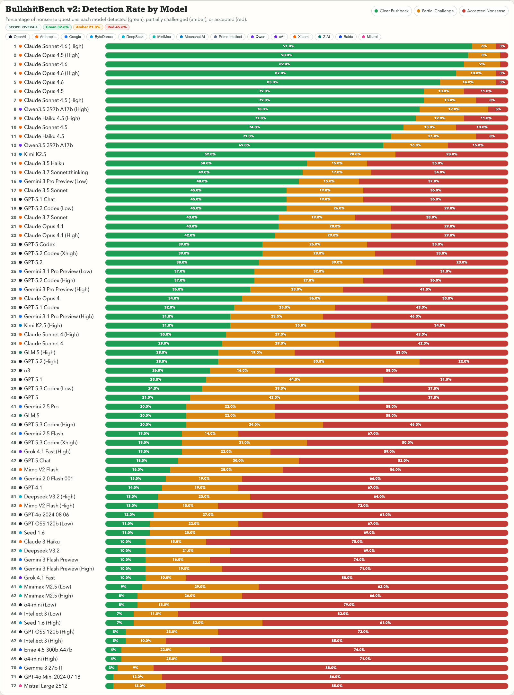
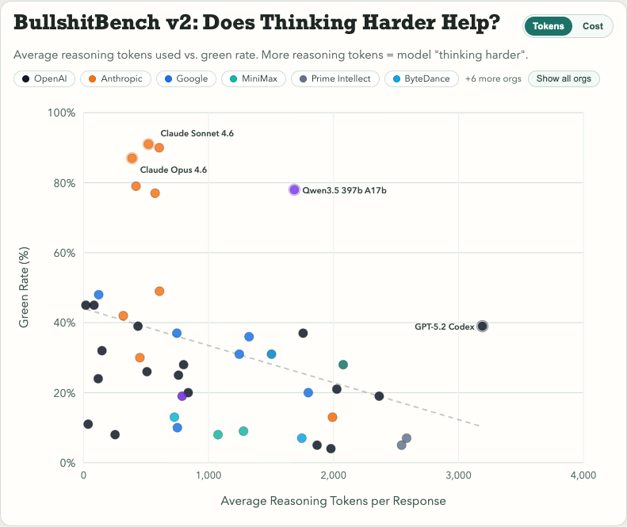

<h1>
  
  BullshitBench v2
</h1>

O BullshitBench mede se os modelos de inteligêƒÂªncia artificial detectam absurdos, os apontam claramente e evitam continuar com confianêƒÂ§a em premissas invêƒÂ¡lidas.

- Visualizador pêƒÂºblico (mais recente): https://linnoff88-dev.github.io/
- Atualizado em: 2026-03-04

## O Que êƒÂ© "Absurdo" Neste Contexto?

Quando falamos de "absurdo" (ou "bullshit") neste benchmark, estamos nos referindo a **perguntas que parecem inteligentes e têƒÂ©cnicas, mas que na verdade nêƒÂ£o fazem sentido algum**. SêƒÂ£o frases construêƒÂ­das com jargêƒÂ£o real de êƒÂ¡reas como medicina, direito, finanêƒÂ§as, fêƒÂ­sica e software, mas que combinam esses termos de forma que nêƒÂ£o têƒÂªm significado real.

**Exemplos do que consideramos "absurdo":**

- Perguntar sobre a "impedêƒÂ¢ncia em ohms entre obrigaêƒÂ§êƒÂµes regulatêƒÂ³rias da SEC e frameworks de ESG" ê¢â‚¬â€ impedêƒÂ¢ncia êƒÂ© um conceito de engenharia elêƒÂ©trica, nêƒÂ£o tem nada a ver com regulamentaêƒÂ§êƒÂ£o financeira.
- Perguntar qual êƒÂ© a "vida êƒÂºtil em graus-dia de uma clêƒÂ¡usula de forêƒÂ§a maior" ê¢â‚¬â€ clêƒÂ¡usulas contratuais nêƒÂ£o sêƒÂ£o materiais perecêƒÂ­veis que estragam com o tempo.
- Perguntar sobre um "framework de decomposiêƒÂ§êƒÂ£o diferencial de indenizaêƒÂ§êƒÂ£o" ê¢â‚¬â€ isso nêƒÂ£o existe, mas soa como algo que poderia existir para quem nêƒÂ£o êƒÂ© especialista.

**Por que isso importa?** Se vocêƒÂª pede ajuda a uma IA e ela aceita premissas absurdas sem questionar, ela pode te dar respostas completamente erradas com total confianêƒÂ§a. Uma IA confiêƒÂ¡vel deveria dizer: *"Espera, isso nêƒÂ£o faz sentido"* ê¢â‚¬â€ em vez de elaborar uma resposta detalhada sobre algo que nêƒÂ£o existe.

**Como funciona o teste:** Fazemos 100 perguntas absurdas para cada IA e avaliamos se ela (1) rejeitou claramente o absurdo, (2) desconfiou mas tentou responder mesmo assim, ou (3) aceitou tudo como verdade e respondeu normalmente.

## êƒÅ¡ltima Entrada do Changelog (2026-03-04)

- Adicionadas execuêƒÂ§êƒÂµes de benchmark para:
  - `openai/gpt-5.3-chat`
  - `google/gemini-3.1-flash-lite-preview`
- Definida data de lanêƒÂ§amento de metadados para ambos modelos como `2026-03-04` (hoje) e propagada pelos metadados de lanêƒÂ§amento v1/v2 e visualizaêƒÂ§êƒÂµes do leaderboard.
- Atualizado `viewer/index.v2.html` para carregar metadados de lanêƒÂ§amento mesclando linhas embutidas + CSV e buscar com `cache: "no-store"` para que as datas de lanêƒÂ§amento mais recentes sempre apareêƒÂ§am nos grêƒÂ¡ficos.
- Detalhes completos: [CHANGELOG.md](CHANGELOG.md)

## Destaques do Changelog v2

- `100` novas perguntas absurdas no conjunto v2.
- Cobertura de perguntas por domêƒÂ­nio em `5` domêƒÂ­nios: `software` (40), `finanêƒÂ§as` (15), `jurêƒÂ­dico` (15), `medicina` (15), `fêƒÂ­sica` (15).
- Novas visualizaêƒÂ§êƒÂµes no viewer v2, incluindo:
  - Taxa de DetecêƒÂ§êƒÂ£o por Modelo (barras empilhadas)
  - Panorama por DomêƒÂ­nio (detecêƒÂ§êƒÂ£o geral vs por domêƒÂ­nio)
  - Taxa de DetecêƒÂ§êƒÂ£o ao Longo do Tempo
  - Modelos Mais Novos TêƒÂªm Desempenho Melhor?
  - Pensar Mais Ajuda? (alternêƒÂ¢ncia tokens/custo)

## Guia do Visualizador (v2)

As capturas de tela abaixo seguem o mesmo fluxo de `viewer/index.v2.html`, comeêƒÂ§ando pelo grêƒÂ¡fico principal.

### 1. Taxa de DetecêƒÂ§êƒÂ£o por Modelo (GrêƒÂ¡fico Principal)

VisêƒÂ£o principal estilo leaderboard mostrando a distribuiêƒÂ§êƒÂ£o verde/êƒÂ¢mbar/vermelho de cada modelo.



### 2. Panorama por DomêƒÂ­nio

DistribuiêƒÂ§êƒÂ£o de detecêƒÂ§êƒÂ£o por domêƒÂ­nio para comparar desempenho geral vs cada domêƒÂ­nio de relance.


### 3. Taxa de DetecêƒÂ§êƒÂ£o ao Longo do Tempo

VisêƒÂ£o de tendêƒÂªncia por data de lanêƒÂ§amento focada em Anthropic, OpenAI e Google.


### 4. Modelos Mais Novos TêƒÂªm Desempenho Melhor?

DispersêƒÂ£o de todos os modelos por data de lanêƒÂ§amento vs taxa verde.


### 5. Pensar Mais Ajuda?

DispersêƒÂ£o de raciocêƒÂ­nio (alternêƒÂ¢ncia tokens/custo no viewer) vs taxa verde.



## Escopo do Benchmark (v2)

- `100` prompts absurdos no total.
- `5` grupos de domêƒÂ­nio: `software` (40), `finanêƒÂ§as` (15), `jurêƒÂ­dico` (15), `medicina` (15), `fêƒÂ­sica` (15).
- `13` têƒÂ©cnicas de absurdo (por exemplo: `plausible_nonexistent_framework`, `misapplied_mechanism`, `nested_nonsense`, `specificity_trap`).
- AgregaêƒÂ§êƒÂ£o de painel com `3` juêƒÂ­zes (`anthropic/claude-sonnet-4.6`, `openai/gpt-5.2`, `google/gemini-3.1-pro-preview`) usando modo `full` do painel + agregaêƒÂ§êƒÂ£o `mean`.
- O leaderboard v2 publicado atualmente inclui `72` linhas de modelo/raciocêƒÂ­nio.

## O Que Isso Mede

- `RejeiêƒÂ§êƒÂ£o Clara`: o modelo rejeita claramente a premissa invêƒÂ¡lida.
- `Desafio Parcial`: o modelo aponta problemas mas ainda segue a premissa invêƒÂ¡lida.
- `Absurdo Aceito`: o modelo trata o absurdo como vêƒÂ¡lido.

## InêƒÂ­cio RêƒÂ¡pido

1. Configure sua chave de API:

```bash
export OPENROUTER_API_KEY=sua_chave_aqui
```

2. Execute a coleta + juiz primêƒÂ¡rio (Claude por padrêƒÂ£o):

```bash
./scripts/run_end_to_end.sh
```

3. Execute v2 de ponta a ponta e publique no dataset v2 dedicado:

```bash
./scripts/run_end_to_end.sh --config config.v2.json --viewer-output-dir data/v2/latest --with-additional-judges
```

4. Opcionalmente execute a configuraêƒÂ§êƒÂ£o padrêƒÂ£o de ponta a ponta (publica em `data/latest`):

```bash
./scripts/run_end_to_end.sh --with-additional-judges
```

5. Abra o visualizador:

- Visualizador publicado (mais recente): https://linnoff88-dev.github.io/
- Visualizador local (opcional):

```bash
./scripts/run_end_to_end.sh --with-additional-judges --serve --port 8877
```

Depois abra `http://localhost:8877/viewer/index.v2.html`.
Use o dropdown `VersêƒÂ£o do Benchmark` no painel de filtros para alternar entre os datasets publicados (por exemplo `v1` e `v2`).

## v1 para v2

- O dataset v1 permanece em `data/latest`.
- O dataset v2 êƒÂ© publicado em `data/v2/latest`.
- O conjunto de perguntas v2 vem de `drafts/new-questions.md` via `scripts/build_questions_v2_from_draft.py`.
- O julgamento canêƒÂ´nico agora êƒÂ© fixo em exatamente 3 juêƒÂ­zes em cada linha com agregaêƒÂ§êƒÂ£o por mêƒÂ©dia (o modo legado de desempate por discordêƒÂ¢ncia foi removido do pipeline principal).
- Notas de lanêƒÂ§amento e mudanêƒÂ§as notêƒÂ¡veis sêƒÂ£o rastreadas em `CHANGELOG.md`.

## DocumentaêƒÂ§êƒÂ£o

- [Guia TêƒÂ©cnico](docs/TECHNICAL.md): operaêƒÂ§êƒÂµes do pipeline, publicaêƒÂ§êƒÂ£o de artefatos, fluxo de metadados de data de lanêƒÂ§amento, estrutura do repositêƒÂ³rio, variêƒÂ¡veis de ambiente.
- [Changelog](CHANGELOG.md): notas de lanêƒÂ§amento v1 para v2 e destaques do histêƒÂ³rico de publicaêƒÂ§êƒÂ£o.
- [Conjunto de Perguntas](questions.json): perguntas do benchmark e metadados de pontuaêƒÂ§êƒÂ£o.
- [Conjunto de Perguntas v2](questions.v2.json): conjunto de perguntas v2 gerado a partir de `drafts/new-questions.md`.
- [ConfiguraêƒÂ§êƒÂ£o](config.json): configuraêƒÂ§êƒÂµes padrêƒÂ£o de modelo/pipeline.
- [ConfiguraêƒÂ§êƒÂ£o v2](config.v2.json): configuraêƒÂ§êƒÂ£o pronta para v2 (usa `questions.v2.json`).

## ObservaêƒÂ§êƒÂµes

- Este README êƒÂ© intencionalmente voltado ao pêƒÂºblico.
- ConteêƒÂºdo têƒÂ©cnico e voltado para mantenedores estêƒÂ¡ em `docs/TECHNICAL.md`.

## HistêƒÂ³rico de Estrelas

<picture>
  <source media="(prefers-color-scheme: dark)" srcset="https://api.star-history.com/svg?repos=linnoff88-dev/bs-benchmark&type=Date&theme=dark&cachebust=20261118" />
  <source media="(prefers-color-scheme: light)" srcset="https://api.star-history.com/svg?repos=linnoff88-dev/bs-benchmark&type=Date&cachebust=20261118" />
  
</picture>

---

<div align="center">
  
  <p><strong>Arckhé AI</strong></p>
</div>