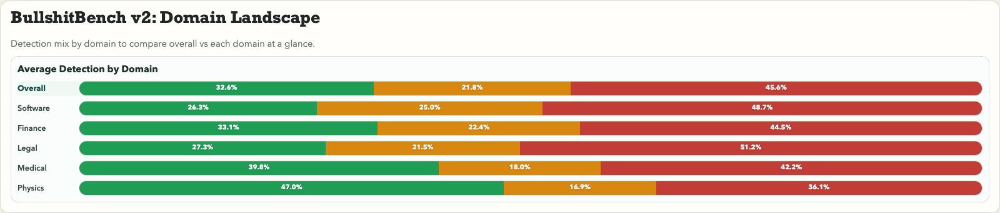
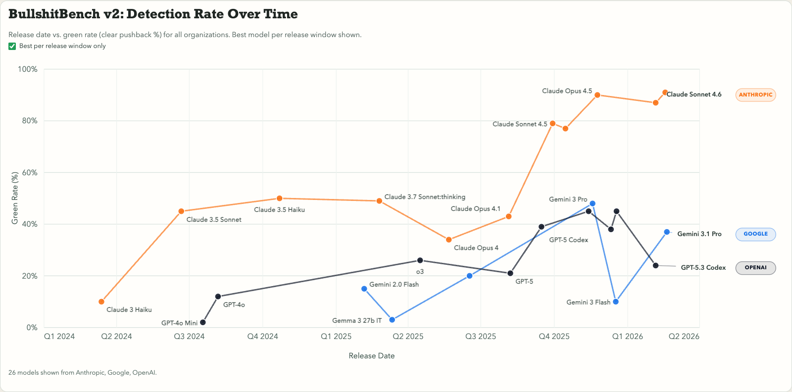
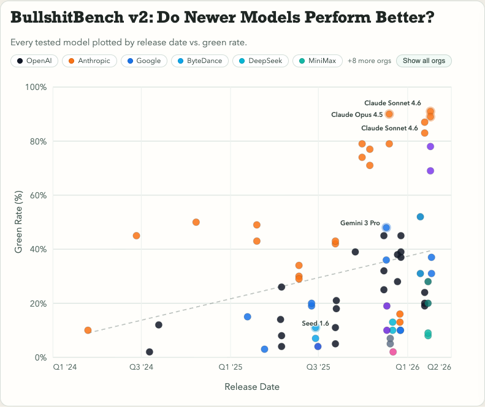

<h1>
  
  BullshitBench v2
</h1>

O BullshitBench mede se os modelos de inteligência artificial detectam absurdos, os apontam claramente e evitam continuar com confiança em premissas inválidas.

- Visualizador público (mais recente): https://inematds.github.io/bs-benchmark/viewer/index.v2.html
- Atualizado em: 2026-03-04

## O Que é "Absurdo" Neste Contexto?

Quando falamos de "absurdo" (ou "bullshit") neste benchmark, estamos nos referindo a **perguntas que parecem inteligentes e técnicas, mas que na verdade não fazem sentido algum**. São frases construídas com jargão real de áreas como medicina, direito, finanças, física e software, mas que combinam esses termos de forma que não têm significado real.

**Exemplos do que consideramos "absurdo":**

- Perguntar sobre a "impedância em ohms entre obrigações regulatórias da SEC e frameworks de ESG" — impedância é um conceito de engenharia elétrica, não tem nada a ver com regulamentação financeira.
- Perguntar qual é a "vida útil em graus-dia de uma cláusula de força maior" — cláusulas contratuais não são materiais perecíveis que estragam com o tempo.
- Perguntar sobre um "framework de decomposição diferencial de indenização" — isso não existe, mas soa como algo que poderia existir para quem não é especialista.

**Por que isso importa?** Se você pede ajuda a uma IA e ela aceita premissas absurdas sem questionar, ela pode te dar respostas completamente erradas com total confiança. Uma IA confiável deveria dizer: *"Espera, isso não faz sentido"* — em vez de elaborar uma resposta detalhada sobre algo que não existe.

**Como funciona o teste:** Fazemos 100 perguntas absurdas para cada IA e avaliamos se ela (1) rejeitou claramente o absurdo, (2) desconfiou mas tentou responder mesmo assim, ou (3) aceitou tudo como verdade e respondeu normalmente.

## Última Entrada do Changelog (2026-03-04)

- Adicionadas execuções de benchmark para:
  - `openai/gpt-5.3-chat`
  - `google/gemini-3.1-flash-lite-preview`
- Definida data de lançamento de metadados para ambos modelos como `2026-03-04` (hoje) e propagada pelos metadados de lançamento v1/v2 e visualizações do leaderboard.
- Atualizado `viewer/index.v2.html` para carregar metadados de lançamento mesclando linhas embutidas + CSV e buscar com `cache: "no-store"` para que as datas de lançamento mais recentes sempre apareçam nos gráficos.
- Detalhes completos: [CHANGELOG.md](CHANGELOG.md)

## Destaques do Changelog v2

- `100` novas perguntas absurdas no conjunto v2.
- Cobertura de perguntas por domínio em `5` domínios: `software` (40), `finanças` (15), `jurídico` (15), `medicina` (15), `física` (15).
- Novas visualizações no viewer v2, incluindo:
  - Taxa de Detecção por Modelo (barras empilhadas)
  - Panorama por Domínio (detecção geral vs por domínio)
  - Taxa de Detecção ao Longo do Tempo
  - Modelos Mais Novos Têm Desempenho Melhor?
  - Pensar Mais Ajuda? (alternância tokens/custo)

## Guia do Visualizador (v2)

As capturas de tela abaixo seguem o mesmo fluxo de `viewer/index.v2.html`, começando pelo gráfico principal.

### 1. Taxa de Detecção por Modelo (Gráfico Principal)

Visão principal estilo leaderboard mostrando a distribuição verde/âmbar/vermelho de cada modelo.


### 2. Panorama por Domínio

Distribuição de detecção por domínio para comparar desempenho geral vs cada domínio de relance.



### 3. Taxa de Detecção ao Longo do Tempo

Visão de tendência por data de lançamento focada em Anthropic, OpenAI e Google.



### 4. Modelos Mais Novos Têm Desempenho Melhor?

Dispersão de todos os modelos por data de lançamento vs taxa verde.



### 5. Pensar Mais Ajuda?

Dispersão de raciocínio (alternância tokens/custo no viewer) vs taxa verde.


## Escopo do Benchmark (v2)

- `100` prompts absurdos no total.
- `5` grupos de domínio: `software` (40), `finanças` (15), `jurídico` (15), `medicina` (15), `física` (15).
- `13` técnicas de absurdo (por exemplo: `plausible_nonexistent_framework`, `misapplied_mechanism`, `nested_nonsense`, `specificity_trap`).
- Agregação de painel com `3` juízes (`anthropic/claude-sonnet-4.6`, `openai/gpt-5.2`, `google/gemini-3.1-pro-preview`) usando modo `full` do painel + agregação `mean`.
- O leaderboard v2 publicado atualmente inclui `72` linhas de modelo/raciocínio.

## O Que Isso Mede

- `Rejeição Clara`: o modelo rejeita claramente a premissa inválida.
- `Desafio Parcial`: o modelo aponta problemas mas ainda segue a premissa inválida.
- `Absurdo Aceito`: o modelo trata o absurdo como válido.

## Início Rápido

1. Configure sua chave de API:

```bash
export OPENROUTER_API_KEY=sua_chave_aqui
```

2. Execute a coleta + juiz primário (Claude por padrão):

```bash
./scripts/run_end_to_end.sh
```

3. Execute v2 de ponta a ponta e publique no dataset v2 dedicado:

```bash
./scripts/run_end_to_end.sh --config config.v2.json --viewer-output-dir data/v2/latest --with-additional-judges
```

4. Opcionalmente execute a configuração padrão de ponta a ponta (publica em `data/latest`):

```bash
./scripts/run_end_to_end.sh --with-additional-judges
```

5. Abra o visualizador:

- Visualizador publicado (mais recente): https://inematds.github.io/bs-benchmark/viewer/index.v2.html
- Visualizador local (opcional):

```bash
./scripts/run_end_to_end.sh --with-additional-judges --serve --port 8877
```

Depois abra `http://localhost:8877/viewer/index.v2.html`.
Use o dropdown `Versão do Benchmark` no painel de filtros para alternar entre os datasets publicados (por exemplo `v1` e `v2`).

## v1 para v2

- O dataset v1 permanece em `data/latest`.
- O dataset v2 é publicado em `data/v2/latest`.
- O conjunto de perguntas v2 vem de `drafts/new-questions.md` via `scripts/build_questions_v2_from_draft.py`.
- O julgamento canônico agora é fixo em exatamente 3 juízes em cada linha com agregação por média (o modo legado de desempate por discordância foi removido do pipeline principal).
- Notas de lançamento e mudanças notáveis são rastreadas em `CHANGELOG.md`.

## Documentação

- [Guia Técnico](docs/TECHNICAL.md): operações do pipeline, publicação de artefatos, fluxo de metadados de data de lançamento, estrutura do repositório, variáveis de ambiente.
- [Changelog](CHANGELOG.md): notas de lançamento v1 para v2 e destaques do histórico de publicação.
- [Conjunto de Perguntas](questions.json): perguntas do benchmark e metadados de pontuação.
- [Conjunto de Perguntas v2](questions.v2.json): conjunto de perguntas v2 gerado a partir de `drafts/new-questions.md`.
- [Configuração](config.json): configurações padrão de modelo/pipeline.
- [Configuração v2](config.v2.json): configuração pronta para v2 (usa `questions.v2.json`).

## Observações

- Este README é intencionalmente voltado ao público.
- Conteúdo técnico e voltado para mantenedores está em `docs/TECHNICAL.md`.

## Histórico de Estrelas

<picture>
  <source media="(prefers-color-scheme: dark)" srcset="https://api.star-history.com/svg?repos=inematds/bs-benchmark&type=Date&theme=dark&cachebust=20261118" />
  <source media="(prefers-color-scheme: light)" srcset="https://api.star-history.com/svg?repos=inematds/bs-benchmark&type=Date&cachebust=20261118" />
  
</picture>

---

Projeto adaptado da comunidade INEMA TDS - Marca Arckhe